<h2 data-importer="text" align="left">Hi 👋! My name.. Ammar Setiawan</h2>

###

###

  
  
  
  
  
  
  
  
  
  
  
  
  
  
  
  
  
  
  
  
  
  
  
  
  
  
  
  
  
  
  
  
  
  
  
  
  
  
  
  
  
  
  
  
  
  
  
  
  

###

 

Saya adalah Fullstack Web Developer dan siswa Sistem Informasi Jaringan yang berfokus pada pengembangan aplikasi web responsif serta infrastruktur sistem yang andal. Mulai dari merancang antarmuka modern dengan Next.js dan Tailwind CSS hingga mengelola server Linux dan konfigurasi jaringan, saya suka menyatukan kode yang bersih dengan sistem yang stabil. Saat ini sedang mendalami interaksi web 3D, game development dengan Godot, dan layanan backend modern.

###

 

  
  
  
  
  
  

###

  
  
  

###

 

###

  

###

 

  

###
